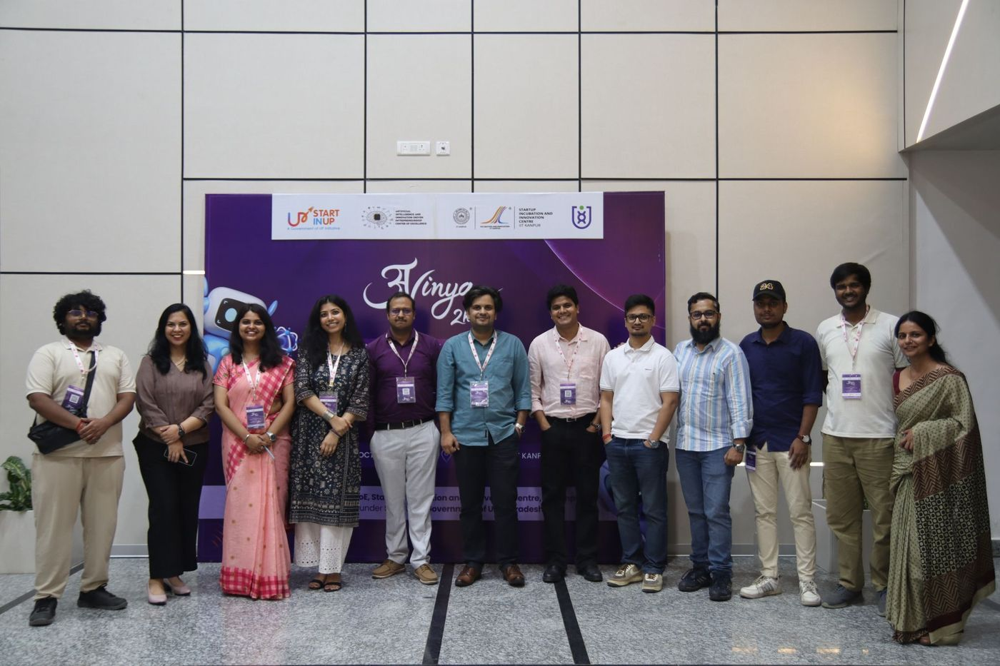
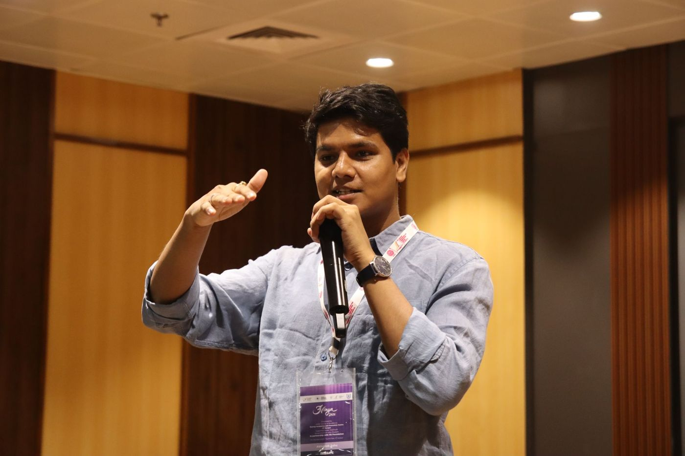
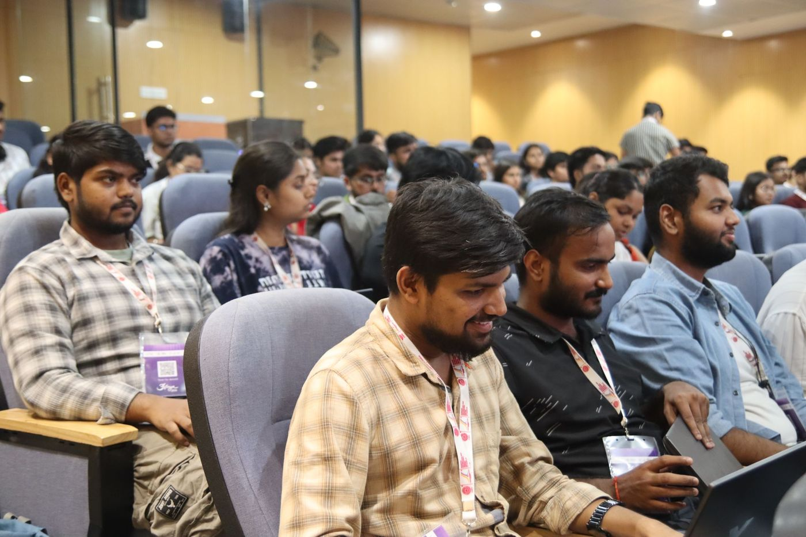
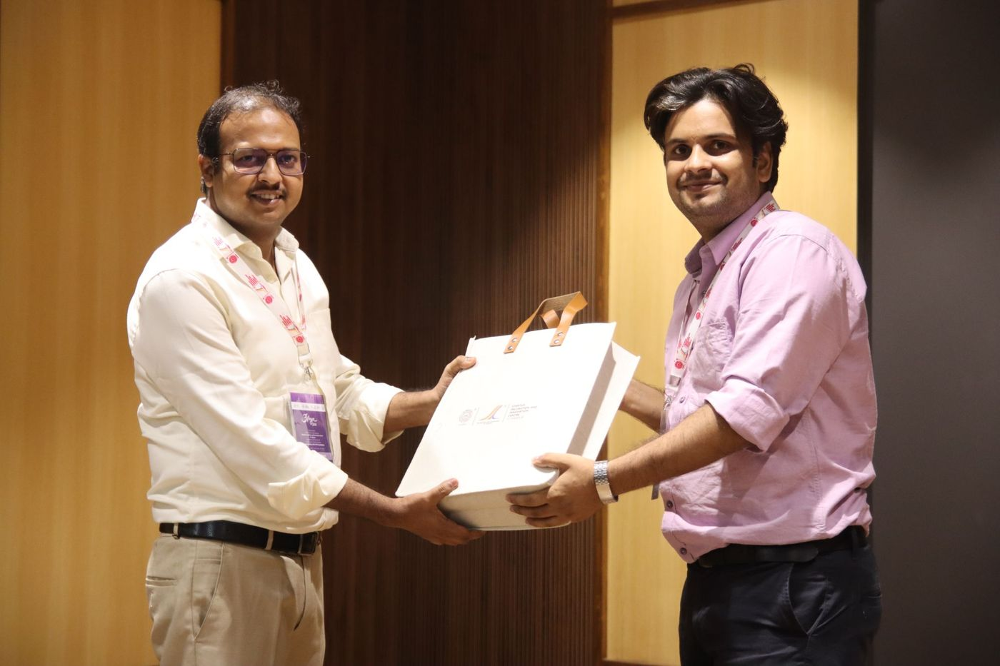

# AVINYA 2K26: AI Innovation Summit and Mini Hackathon

{: .note }
8 and 9 October 2026 &middot; Techno Park, IIT Kanpur

AVINYA 2K26 was a two-day AI innovation summit and mini hackathon, organised by the AIIDE Centre of Excellence at the Startup Incubation and Innovation Centre (SIIC), IIT Kanpur. It was supported under the Uttar Pradesh Startup Mission of the Government of Uttar Pradesh, in partnership with HS Foundation India. UPAI Labs (Lucknow AI Labs) gave technical support and ran the workshop on the first day.

  
At the AVINYA 2K26 backdrop, Techno Park, IIT Kanpur.

## Day 1: agentic AI and workflow automation

Our team led a hands-on workshop on agentic AI and workflow automation. Through live demos and step-by-step builds, participants saw how AI agents and automated workflows work, and got practice building their own. One exercise started from a problem everyone in the room knew, potholes on the roads, and asked how an AI application could help deal with it.

The workshop closed with the problem statements for the mini hackathon, so teams had the evening to prepare.

  
Abhishek Sahu of UPAI Labs at AVINYA 2K26.

  
Participants at AVINYA 2K26.

## Day 2: mini hackathon

Teams built solutions to the problem statements and pitched them to the jury.

- **First prize (₹25,000): Team Rubrics**, Babu Banarasi Das Institute of Technology and Management: Etisheee Tiwari, Ashish Shukla, Deepak Kumar and Avanisha Sharma.
- **Also on the podium:** Team Afterburners (Shree Ramswaroop Memorial College of Engineering and Management) and Team Velocity (GD Goenka University).

## The UPAI Labs team

[Bhavishya Pandit](https://www.linkedin.com/in/superbhavishya/), [Abhishek Sahu](https://www.linkedin.com/in/a-sahu16/), [Prashant Shukla](https://www.linkedin.com/in/prashant-shukla30/), [Mayank Bhaskar](https://www.linkedin.com/in/cataluna84/), [Sanjay Singh Chauhan](https://www.linkedin.com/in/sanjaychauhansingh20/), Aayush Sharma, Anshul Yadav and Priyanshu.

  
A memento from SIIC IIT Kanpur.

## In the news

- *Aaj* (Hindi daily), page 4, 13 October 2026: "एआई का उपयोग रोजमर्रा की समस्याओं को हल करने में करें" (Use AI to solve everyday problems). A report on the workshop that credits the UPAI Labs team with running it.

## Credits

Organised by the AIIDE Centre of Excellence, [Startup Incubation and Innovation Centre, IIT Kanpur](https://www.linkedin.com/company/incubatoriitk/). Supported under the [Uttar Pradesh Startup Mission](https://www.linkedin.com/company/startupinup/), Government of Uttar Pradesh, in partnership with [HS Foundation India](https://www.linkedin.com/company/hs-foundation-india/). Technical support from UPAI Labs (Lucknow AI Labs). Event page on the [SIIC IIT Kanpur website](https://siicincubator.com/upcoming-events/avinya-2k26).
