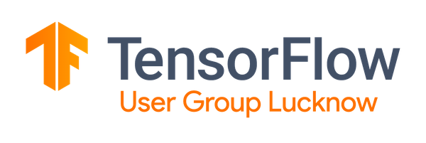
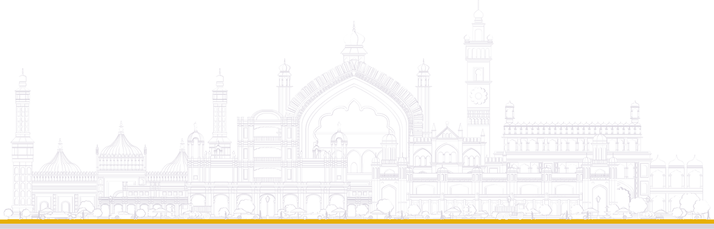

{%- assign today = site.time | date: "%Y-%m-%d" -%}





  
    
    
    
    
  



  
Chapter 1 of UPAI Labs

  <h1 class="fs-9 mb-2">Lucknow AI Labs</h1>
  
A volunteer-run community where students and engineers in Lucknow learn, build and research AI together. Since November 2023.

  <a href="{{ '/events/' | relative_url }}" class="btn btn-primary fs-5">Upcoming events</a>
  <a href="#join-the-community" class="btn fs-5">Join the community</a>
  <a href="https://github.com/LucknowAI" class="btn fs-5">Contribute on GitHub</a>

## Next event



## What we do

Spreading AI and knowledge sharing throughout Lucknow, and from here to the rest of Uttar Pradesh.

<ul class="lai-grid">
  <li class="lai-card">
    <h3>Education and knowledge sharing</h3>
    
Hands-on meetups and workshops on AI tools and techniques, run with colleges and other communities, in Lucknow and in smaller cities and villages across Uttar Pradesh.

    
<a href="{{ '/events/' | relative_url }}">All events</a>

  </li>
  <li class="lai-card">
    <h3>Hackathons</h3>
    
From 24-hour online sprints to Hack-e-Awadh, our own offline hackathon.

    
<a href="{{ '/hackathons/' | relative_url }}">Hackathons</a>

  </li>
  <li class="lai-card">
    <h3>AI and ML research</h3>
    
Regular paper reading sessions on recent machine learning research, and research projects of our own.

    
<a href="{{ '/research/' | relative_url }}">Research</a>

  </li>
  <li class="lai-card">
    <h3>Open source</h3>
    
Community-built projects such as NAWAB AI, Loki LLM and the Awadhi language project, open for anyone to use and improve.

    
<a href="{{ '/projects/' | relative_url }}">Projects</a>

  </li>
  <li class="lai-card">
    <h3>अवधी NLP and data</h3>
    
Data and language tools for Awadhi, and for Hindi and other low-resource languages.

    
<a href="{{ '/projects/awadhi-language-project/' | relative_url }}">Awadhi language project</a>

  </li>
  <li class="lai-card">
    <h3>Startups and local problems</h3>
    
Mentorship for people building AI startups, and AI applied to everyday problems in our own city.

    
<a href="{{ '/mentorship/' | relative_url }}">Mentorship</a>

  </li>
</ul>

## By the numbers

<ul class="lai-grid lai-stats">
  <li class="lai-card">{{ n_events }}events since November 2023</li>
  <li class="lai-card">{{ n_hackathons }}hackathons</li>
  <li class="lai-card">{{ n_papers }}paper reading sessions</li>
  <li class="lai-card">{{ site.data.projects.active | size }}active open-source projects</li>
</ul>

Counted from our <a href="{{ '/events/' | relative_url }}">events list</a>, which includes events run with AI Community Lucknow and other partner communities.

## Recent events

<ul class="lai-grid">

  
  
  <li class="lai-card">
    


    <h4><a href="{{ href }}">{{ e.title }}</a>{{ e.title }}</h4>
    
{{ e.date | date: "%-d %B %Y" }}. {{ e.note }}

  </li>

</ul>

## Part of UPAI Labs

Lucknow AI Labs is the first chapter of [UPAI Labs Foundation](https://upailabs.org) (Uttar Pradesh AI Labs), a Section 8 not-for-profit company incorporated in March 2025 to grow the AI ecosystem across Uttar Pradesh. Many of our events are run together with AI Community Lucknow, GDG Lucknow and colleges across the city. [More about us](about/).

## Collaborations

AI Community Lucknow, earlier TensorFlow User Group Lucknow, co-hosts many of our events.

## Join the community

| Where | What happens there |
|:--|:--|
| [WhatsApp](https://chat.whatsapp.com/IAM2fp4IoLiGbuI6ZeNfzH) | Announcements and community chat |
| [Discord](https://discord.gg/QKw67PDZUm) | Technical discussions, projects and paper reading |
| [Commudle](https://www.commudle.com/communities/upai-labs) | Event registrations |
| [LinkedIn](https://www.linkedin.com/company/lucknow-ai-labs/), [X](https://x.com/AILucknow), [Instagram](https://www.instagram.com/lucknow_ai/), [YouTube](https://www.youtube.com/@lucknowailabs) | News, photos and recordings |

Want to help run events, mentor or build? See [Get involved](get-involved/).

## Contributors

Thank you to everyone who has contributed to this website and to Lucknow AI Labs on GitHub.

<ul class="list-style-none">

  <li class="d-inline-block mr-1">
    
  </li>

</ul>

Everyone taking part in Lucknow AI Labs follows our [code of conduct](code-of-conduct/).

