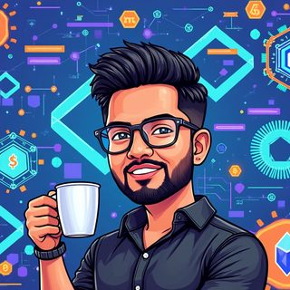

# AI Baithak ke Sadasya

Lucknow AI Labs is run by volunteers. Here are some of them, in their AI Baithak avatars. The community is led by its founding team, Ankit Kumar Pal (Aaditya), Prashant Shukla and Abhishek Sahu; see [About](/about/).

---

## Rag Rishi

**Name:** [Abhishek Sahu](https://www.linkedin.com/in/a-sahu16/)
**About:** Abhishek is a Flutter developer by profession, but his heart truly beats for RAG (retrieval-augmented generation). Wherever he sees documents, the first words out of his mouth are, "Arey, ispe RAG kyun nahi laga rahe ho?" His passion for optimising retrieval systems and vector databases makes him a true RAG devotee.

And there is more: Abhishek also sings actual raag. When he is not diving into neural networks, he is probably singing classical Indian ragas. Whether it is a complex query or a classical tune, Rag Rishi will always find the right note.

---

## Machine Mantri

**Name:** [Prashant Shukla](https://www.linkedin.com/in/prashant-shukla30/)
**About:** Prashant, aka Machine Mantri, runs his own ministry of robots and AI. From making bots play drums to ruling the world of Arduino and edge devices, he has it all under control.

When he is not coding a bot's next move, you will find him watching his favourite anime for even more futuristic inspiration. If there is a tech problem, Machine Mantri will solve it, probably with a side of robot rock music.

---

## Blockchain Babu

**Name:** [Harsh Joshi](https://www.linkedin.com/in/getharsh/)
**About:** Harsh's mantra is simple: "Centralization ko chhodo, sab kuch blockchain pe lao!" Whether it is AI, chai or even your friendships, Harsh believes everything should run on a decentralised ledger.

From smart contracts to Web3: Blockchain Babu ke hote hue, even your chai breaks might get decentralised.

---

## Speech Shastri

**Name:** [Gauraangi](https://www.linkedin.com/in/gauraangi/)
**About:** Gauraangi, aka Speech Shastri, does not just hear voices; she makes AI listen to them. A master of turning sound into smarts, she cracked the code at the Hack to Crack hackathon.

From building speech models to fine-tuning them like a classical raag, Speech Shastri's mantra is simple: "If it talks, I'll make AI understand it!"

---

## Diffusion Dada

**Name:** Kaif
**About:** Kaif is your go-to person for anything to do with image models. A blurry image, an artefact problem or just a random curiosity? Kaif's first reaction is always, "Chalo Stable Diffusion lagate hain!"

Upscaling, inpainting or generating new visuals, Kaif can tackle it all. Just don't be surprised if he starts giving life advice based on latent spaces.

---

## Ask them anything

Questions about images, RAG, blockchain or AI? Ask our members on [Discord](https://discord.gg/QKw67PDZUm). Want to join the team? See [Get involved](/get-involved/).
